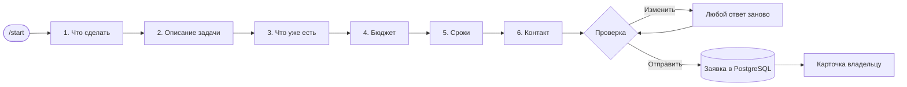

# Obsidra Brief Bot

Telegram-бот, который собирает заявки на разработку. Клиент отвечает на 6 коротких вопросов, бот присылает владельцу готовую карточку, а заявка сохраняется в PostgreSQL. Бот говорит с клиентом по-русски или по-английски.

**Стек:** Java 21 · Spring Boot 4 · TelegramBots 10 (long polling) · PostgreSQL + Flyway · Redis · JUnit 5 · Mockito · Testcontainers · Docker Compose · GitHub Actions

## Как устроен диалог



- Ответ кнопкой заменяет сообщение с вопросом на «вопрос → ответ», поэтому история в чате остаётся читаемой.
- «Что уже есть» — множественный выбор с ✅. «Только идея» исключает остальные варианты.
- Любой ответ можно поменять с карточки подтверждения, после этого бот сразу возвращается к карточке.
- Черновик живёт в Redis 24 часа: можно уйти и продолжить позже. `/start` предложит продолжить или начать заново.
- От одного человека принимается не больше 3 заявок в сутки.
- `/cancel` удаляет незаконченную заявку, а уже отправленную предлагает отозвать (если активных несколько — даёт выбрать). Отозвать можно только свою заявку, пока она новая или в работе; владелец получает уведомление.
- Владельцу приходит карточка с кнопками «Взял в работу» и «Отклонить». Решение по уже разобранной или отозванной заявке кнопки не перезаписывают.

### Языки

- Язык берётся из настроек Telegram клиента (`language_code`): `ru`, `uk`, `be`, `kk` и пустое значение — русский, всё остальное — английский.
- На приветствии есть кнопка «🇬🇧 English» / «🇷🇺 Русский». Выбор запоминается и важнее настроек Telegram: в Redis без срока жизни, в профиле `local` — в памяти до перезапуска.
- Все тексты, кнопки и вопросы лежат в `src/main/resources/messages_ru.properties` и `messages_en.properties`. Тест проверяет, что у каждого ключа есть оба перевода с одинаковыми подстановками `{0}` и HTML-разметкой.
- Варианты бюджета у каждого языка свои (`bot.budgets.ru` и `bot.budgets.en` в `application.yml`): в рублях и в долларах.
- Карточка заявки и админ-команды всегда на русском. В карточке есть строка «Язык клиента», язык сохраняется в заявке (колонка `leads.language`).

### Команды

| Команда | Кто | Что делает |
|---|---|---|
| `/start` | все | начать заявку или продолжить незаконченную |
| `/cancel` | все | удалить черновик или отозвать отправленную заявку |
| `/myid` | все | показать свой Telegram ID (для `BOT_ADMIN_CHAT_ID`) |
| `/leads` | владелец | последние 10 заявок |
| `/lead 1001` | владелец | карточка заявки с текущим статусом |
| `/stats` | владелец | заявки за неделю по типам и статусам |

## Архитектура

```
src/main/java/dev/obsidra/briefbot/
├── config/     BotProperties — настройки из application.yml
├── message/    Reply, Button, BotResponse — ответы бота без привязки к Telegram API
├── dialog/     DialogService (сценарий по шагам Step), Draft, черновики в Redis (или в памяти — профиль local), Texts
├── i18n/       Language (выбор по language_code), выбранный клиентом язык в Redis (или в памяти — профиль local)
├── lead/       Lead (JPA), LeadService (лимит, статусы, статистика), LeadRepository
├── notify/     карточка заявки и уведомление владельцу после коммита транзакции
├── admin/      /leads, /stats, кнопки статуса
└── telegram/   приём апдейтов, маршрутизация команд, отправка через Bot API
```

Главное решение — **`DialogService` ничего не знает о Telegram**. Он получает действие клиента и возвращает `BotResponse`: какие сообщения отправить или заменить и какую подсказку показать над кнопкой. Перевод в вызовы Bot API живёт отдельно, в `ReplySender`. Поэтому весь сценарий проверяется обычными юнит-тестами, без сети и без моков Telegram.

Уведомление владельцу отправляется через `@TransactionalEventListener` — только после того, как заявка точно сохранилась в базе.

## Запуск

Нужны Docker и бот, созданный в [@BotFather](https://t.me/BotFather).

```bash
cp .env.example .env    # впишите BOT_TOKEN и POSTGRES_PASSWORD
docker compose up -d --build
```

Затем напишите боту `/myid`, впишите полученное число в `BOT_ADMIN_CHAT_ID` в `.env` и перезапустите бота:

```bash
docker compose up -d
```

Теперь заявки приходят вам, а команды `/leads` и `/stats` отвечают только на ваш ID.

Варианты бюджета для каждого языка, лимит заявок, время жизни черновика и ссылки задаются в `src/main/resources/application.yml`, в секции `bot`. Тексты бота — в `src/main/resources/messages_*.properties`.

### Без Docker (на своём компьютере)

Профиль `local` читает настройки из `.env`, хранит черновики в памяти (Redis не нужен) и подключается к локальному PostgreSQL по `127.0.0.1`.

```powershell
powershell -ExecutionPolicy Bypass -File tools\setup-local-db.ps1   # создаст пользователя и базу briefbot
./mvnw -DskipTests package
java -jar target/brief-bot.jar --spring.profiles.active=local
```

Скрипт сам сгенерирует пароль базы в `.env`, а пароль суперпользователя `postgres` спросит у вас.

### Если api.telegram.org недоступен напрямую

Укажите прокси в `.env`: `BOT_PROXY=http://127.0.0.1:2080` или `socks5://…`. При старте бот делает до 5 попыток подключиться, а отправку сообщения повторяет при обрыве сети.

## Тесты

```bash
./mvnw verify
```

- `DialogServiceTest` — весь сценарий брифа: полный путь на русском и на английском, переключение языка, валидация, множественный выбор, устаревшие кнопки, редактирование, лимит, экранирование HTML, отзыв заявки.
- `TextsTest`, `LanguageTest` — у всех ключей есть оба перевода, выбор языка по `language_code`.
- `BriefBotUpdateConsumerTest` — язык клиента из апдейта Telegram и приоритет выбранного вручную.
- `LeadCardsTest` — карточка владельцу на русском с пометкой языка клиента.
- `BriefBotIntegrationTest` — контекст приложения против настоящих PostgreSQL и Redis в Docker (Testcontainers): миграции Flyway, массивы PostgreSQL, TTL черновиков, язык заявки и выбранный язык в Redis, лимит, статистика, правила отзыва.
- `TelegramConfigTest`, `CommandParsingTest` — настройка прокси и разбор команд.
- `BotPropertiesTest` — в `application.yml` есть варианты бюджета для каждого языка.

Для интеграционных тестов нужен запущенный Docker.

## Безопасность

- Токен бота и пароль базы хранятся только в `.env`, который не попадает в git.
- PostgreSQL и Redis не открыты наружу: к ним обращается только бот внутри сети compose.
- Весь пользовательский ввод экранируется перед вставкой в HTML-сообщения.
- Бот отвечает только в личных сообщениях, админ-команды проверяют Telegram ID.
- Приложение в контейнере работает не от root.
